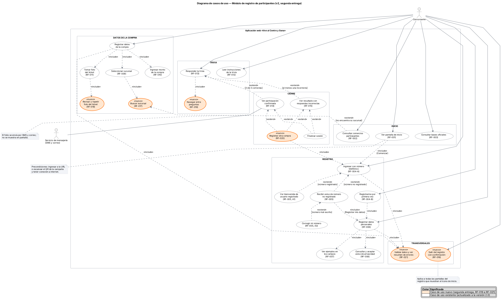

# Diagramas UML

## Diagrama de casos de uso

| Versión | Archivo | Descripción |
|---|---|---|
| **2.0 (vigente)** | [casos-de-uso-v2.png](casos-de-uso-v2.png) · [SVG](casos-de-uso-v2.svg) · [fuente PlantUML](casos-de-uso-v2.puml) | Segunda entrega. Incluye RF-001 a RF-021. |
| 1.0 | [Diagrama de casos de uso (UML).pdf](<Diagrama de casos de uso (UML).pdf>) | Primera entrega. Se conserva como evidencia de la evolución de los requisitos. |



### Qué cambió de la versión 1.0 a la 2.0

**Casos de uso nuevos** (en naranja en el diagrama):
- Buscar sucursal (RF-017)
- Revisar y repetir la foto del ticket (RF-018)
- Navegar entre preguntas (RF-019)
- Registrar otra compra (RF-020)
- Salir del registro con confirmación (RF-016)
- Validar datos y ver resumen de errores (RF-021)

**Casos de uso que cambian:**
- "Iniciar sesión con el número de teléfono" pasa a **"Ingresar con número telefónico" (RF-004-A)**. Lo extienden "Recibir aviso de número no registrado" (RF-005), "Ver bienvenida de usuario registrado" (RF-005, A1) y "Corregir mi número" (RF-005, A3).
- Se agrega **"Registrarme por primera vez" (RF-004-B)** como camino directo al registro.
- Los seis campos del formulario de datos ("Ingresar nombre(s)", "Ingresar primer apellido", etc.) se agrupan en **"Registrar datos personales" (RF-006)**, que incluye los ejemplos (RF-007), el aviso de privacidad (RF-008) y la validación (RF-021).
- **"Volver a participar"** se sustituye por **"Registrar otra compra" (RF-020)** y **"Finalizar sesión"**, que extienden los dos resultados de la trivia.
- El caso **"Recibir un mensaje de participación exitosa y su folio por SMS"** pasa a **"Ver participación confirmada" (RF-014)**, asociado al actor secundario **"Servicio de mensajería (SMS y correo)"**. El folio se envía por SMS y correo, pero no se muestra en pantalla.
- Se quitan los casos **"Brindar el correo electrónico de un conocido"** y **"Revisar cuál es su correo electrónico"**, porque no están respaldados por ningún requisito funcional vigente. Si el equipo los considera necesarios, deben redactarse como RF antes de volver al diagrama.

**Precondiciones:** "Ingresar a la URL o escanear el QR" y "Tener conexión a internet" ahora aparecen como nota del caso "Ver pantalla de inicio" (RF-001), porque son precondiciones y no acciones del sistema.

### Cómo regenerar la imagen
1. Descarga [PlantUML](https://plantuml.com/download) (requiere Java y Graphviz).
2. Ejecuta:

```bash
java -jar plantuml.jar -tsvg casos-de-uso-v2.puml
java -jar plantuml.jar -tpng casos-de-uso-v2.puml
```
