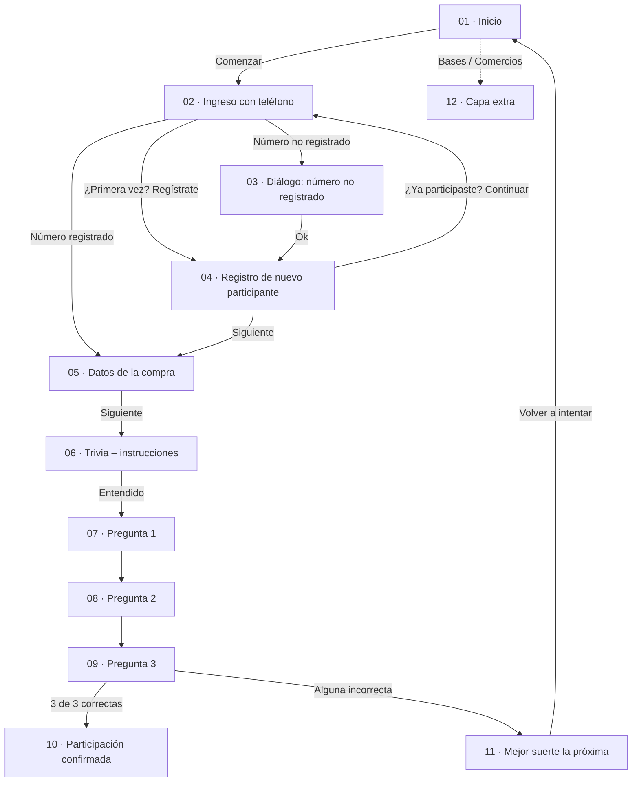
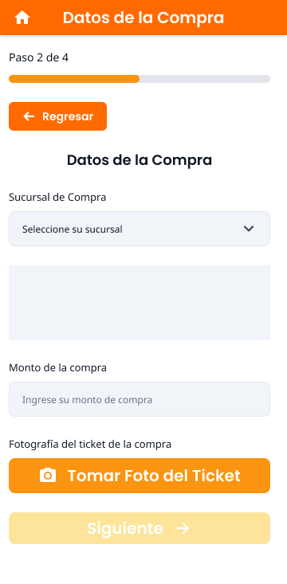
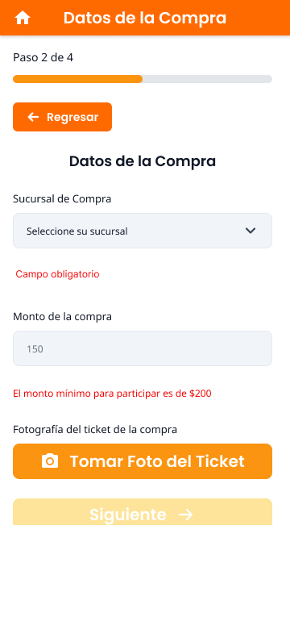

# Pantallas del flujo de registro

Inventario de las pantallas diseñadas en [Figma](https://www.figma.com/design/sVxsBw6xtnTPWCtjMJrPL7/Ven-al-Centro-y-Gana-%E2%80%93-Flujo-de-registro?node-id=0-1&t=DLfkUYIZnpshV6pP-0), su propósito y su correspondencia con los requisitos funcionales (RF) y las historias de usuario (HU).

- **Formato de pantalla:** 360 × 800 px (móvil); la pantalla 04 mide 360 × 923 px porque tiene scroll.
- **Etapas del flujo:** 1. Registro → 2. Datos de la compra → 3. Trivia → 4. Resultado.

---

## Flujo de navegación

---

## Matriz de correspondencia (pantalla ↔ requisito)

| Pantalla | RF | HU | Estado |
|---|---|---|---|
| 01 · Inicio | RF-001, RF-002, RF-003 | HU-001, HU-002, HU-003 | ⚠️ Falta la flecha de *scroll down* que pide RF-001 |
| 02 · Ingreso con teléfono | RF-004-A, RF-004-B, RF-008 | HU-004-A, HU-004-B, HU-008 | ✅ |
| 03 · Teléfono no registrado | RF-005 | HU-005 | ✅ |
| 04 · Registro de nuevo participante | RF-006, RF-007, RF-008 | HU-006, HU-007, HU-008 | ✅ |
| 05 · Datos de la compra (y estados) | RF-009, RF-010, RF-011 | HU-009, HU-010, HU-011 | ⚠️ Falta un estado de foto ya tomada (vista previa) |
| 06 · Trivia – instrucciones | RF-012 | HU-012 | ✅ |
| 07–09 · Trivia – preguntas | RF-013 | HU-013 | ✅ |
| 10 · Participación confirmada | RF-014 | HU-014 | ⚠️ Falta mostrar el folio en pantalla |
| 11 · Mejor suerte la próxima | RF-015 | HU-015 | ✅ |
| 12 · Capa extra | RF-002, RF-003, RF-008 | HU-002, HU-003, HU-008 | Marcador de posición |

Todas las pantallas se diseñaron con un ancho de 360 px, el mínimo que exige **RNF-001** (portabilidad), y siguen las pautas de usabilidad de **RNF-002 a RNF-006**.

---

## Detalle por pantalla

### 01 · Inicio

**Propósito:** explicar la campaña en segundos y llevar al usuario al botón "Comenzar".
- Logo de la campaña y título: "Convierte tus compras en recompensas".
- **Tres pasos ilustrados con íconos:** registrar datos, subir la foto del ticket y responder la trivia.
- Texto con la regla principal: compras de $200 o más.
- Botón **"Comenzar"** destacado (amarillo, 44 px de alto, ancho completo).
- Enlaces a las bases y a la lista de comercios participantes.

**Problema que resuelve:** en la prueba de campo, las personas de 60 a 70 años no encontraban el botón "Comenzar" (RF-001).

---

### 02 · Ingreso con teléfono

**Propósito:** identificar si el concursante ya está registrado.
- Indicador **Paso 1 de 4**.
- Campo "Teléfono" y casilla de aceptación del aviso de privacidad.
- Botón "Siguiente" **deshabilitado** hasta que el formulario sea válido.
- Enlace "¿Primera vez participando? Presione aquí para registrarse" (RF-004-B).

---

### 03 · Teléfono no registrado (diálogo)

**Propósito:** avisar que el número no existe y redirigir al registro (RF-005).
- Overlay oscuro sobre la pantalla 02.
- El mensaje muestra el número ingresado, para que el usuario verifique si se equivocó.
- Una sola acción: "Ok".

---

### 04 · Registro de nuevo participante

**Propósito:** capturar los datos personales (RF-006).
- Seis campos: nombre(s), primer apellido, segundo apellido, teléfono, correo electrónico y domicilio.
- **Ejemplos junto a cada etiqueta** (por ejemplo "Ej.: Juan Carlos"), como pide RF-007.
- Aviso de privacidad con enlace y casilla (RF-008).
- Enlace de regreso: "¿Ya ha participado antes? Presione aquí para continuar".

---

### 05 · Datos de la compra
  

**Propósito:** registrar la sucursal, el monto y la foto del ticket.
- **Paso 2 de 4** y botón "Regresar".
- Selector de sucursal (RF-009). El estado desplegado muestra la lista de sucursales.
- Campo de monto (RF-010) con validación: *"El monto mínimo para participar es de $200"*.
- Mensaje *"Campo obligatorio"* cuando no se selecciona sucursal.
- Botón con ícono **"Tomar foto del ticket"** (RF-011).

**Estados diseñados:** vacío, selector desplegado y errores de validación.

---

### 06 · Trivia – instrucciones

**Propósito:** preparar al usuario antes de la trivia (RF-012).
- **Paso 3 de 4**, título "Contesta la Trivia" e instrucción en lenguaje simple.
- Botón "Entendido" y botón "Regresar".

---

### 07–09 · Trivia – preguntas 1, 2 y 3

**Propósito:** responder las 3 preguntas de opción múltiple (RF-013).
- Contador visible: "Pregunta 1 de 3".
- Pregunta en tipografía grande (Poppins SemiBold).
- Tres opciones tipo *radio* con área táctil de 48 px.
- Preguntas redactadas en **lectura fácil** (RNF-006), por ejemplo "¿Qué usamos para cortar papel?".

| Pantalla | Pregunta | Captura |
|---|---|---|
| 07 | ¿Qué animal es conocido por tener una trompa larga? | `screens/07-trivia-question-1.png` |
| 08 | ¿Qué usamos para cortar papel? | `screens/08-trivia-question-2.png` *(pendiente de exportar)* |
| 09 | En la explanada del parque de la… | `screens/09-trivia-question-3.png` *(pendiente de exportar)* |

---

### 10 · Participación confirmada
*Captura pendiente de exportar como `screens/10-participation-confirmed.png`.*

**Propósito:** confirmar el registro exitoso (RF-014).
- Ícono de éxito (check) y título "Participación Confirmada".
- Mensaje de felicitación por responder correctamente la trivia.
- Aviso de que se envió un mensaje de texto con el folio.
- Botón para volver al inicio.

---

### 11 · Mejor suerte la próxima
*Captura pendiente de exportar como `screens/11-better-luck-next-time.png`.*

**Propósito:** cerrar el flujo cuando falla la trivia, sin frustrar al usuario (RF-015).
- Ícono de error (x) y título "¡Gracias por participar!".
- Explica que no respondió correctamente todas las preguntas.
- Indica que puede volver a intentarlo usando el mismo número telefónico.
- Botón para reintentar.

---

### 12 · Capa extra
*Captura pendiente de exportar como `screens/12-extra-layer.png`.*

**Propósito:** marcador de posición para el contenido externo: bases para participar, avisos de privacidad y sucursales participantes.

---

## Iteraciones registradas en Figma

En el archivo hay **tres versiones de la pantalla 05 · Datos de la compra**. Muestran cómo evolucionó la colocación de los mensajes de error: primero se superponían al campo y después se integraron en el flujo del formulario, con espacio propio. Esto sirve como evidencia del refinamiento del diseño.
