# Pantallas del flujo de registro

Inventario de las pantallas diseñadas en [Figma](https://www.figma.com/design/sVxsBw6xtnTPWCtjMJrPL7/Ven-al-Centro-y-Gana-%E2%80%93-Flujo-de-registro?node-id=0-1&t=DLfkUYIZnpshV6pP-0), su propósito y su correspondencia con los requisitos funcionales (RF) y las historias de usuario (HU).

- **Versión del diseño:** 2.0 (segunda entrega).
- **Formato de pantalla:** 360 × 800 px (móvil). Las pantallas 04 y 04b miden 360 × 1160 px porque tienen scroll.
- **Etapas del flujo:** 1. Registro → 2. Datos de la compra → 3. Trivia → 4. Resultado.
- **Total:** 17 pantallas (incluye estados de error, diálogos y paneles).

---

## Flujo de navegación

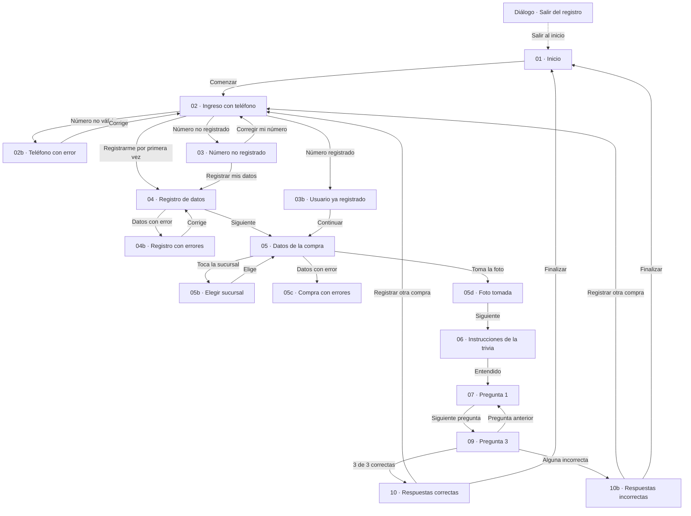

> El diálogo **Salir del registro** aparece al tocar el ícono de inicio en cualquier pantalla del registro (RF-016).

---

## Matriz de correspondencia (pantalla ↔ requisito)

| Pantalla | Captura | RF | HU | RNF |
|---|---|---|---|---|
| 01 · Inicio | [01-home.png](screens/01-home.png) | RF-001, RF-002, RF-003 | HU-001, HU-002, HU-003 | RNF-008 |
| 02 · Ingreso con teléfono | [02-phone-login.png](screens/02-phone-login.png) | RF-004-A, RF-004-B | HU-004-A, HU-004-B | RNF-007, RNF-009 |
| 02b · Teléfono con error | [02b-phone-error.png](screens/02b-phone-error.png) | RF-004-A, RF-021 | HU-004-A, HU-021 | RNF-010 |
| 03 · Número no registrado | [03-phone-not-registered-dialog.png](screens/03-phone-not-registered-dialog.png) | RF-005 | HU-005 | — |
| 03b · Usuario ya registrado | [03b-returning-user.png](screens/03b-returning-user.png) | RF-005 (A1) | HU-005 | RNF-011 |
| Diálogo · Salir del registro | [exit-confirmation-dialog.png](screens/exit-confirmation-dialog.png) | RF-016 | HU-016 | RNF-003 |
| 04 · Registro de nuevo participante | [04-new-participant-registration.png](screens/04-new-participant-registration.png) | RF-006, RF-007, RF-008, RF-004-B (A2) | HU-006, HU-007, HU-008 | RNF-002, RNF-009 |
| 04b · Registro con errores | [04b-registration-errors.png](screens/04b-registration-errors.png) | RF-006, RF-008, RF-021 | HU-006, HU-008, HU-021 | RNF-010 |
| 05 · Datos de la compra | [05-purchase-data.png](screens/05-purchase-data.png) | RF-009, RF-010, RF-011 | HU-009, HU-010, HU-011 | RNF-009 |
| 05b · Elegir sucursal | [05b-branch-search.png](screens/05b-branch-search.png) | RF-017, RF-002 (A2) | HU-017, HU-002 | RNF-004 |
| 05c · Compra con errores | [05c-purchase-data-errors.png](screens/05c-purchase-data-errors.png) | RF-009, RF-010, RF-011, RF-021 | HU-009, HU-010, HU-011, HU-021 | RNF-010 |
| 05d · Compra completa (foto tomada) | [05d-purchase-data-photo-taken.png](screens/05d-purchase-data-photo-taken.png) | RF-018 | HU-018 | — |
| 06 · Instrucciones de la trivia | [06-trivia-instructions.png](screens/06-trivia-instructions.png) | RF-012 | HU-012 | RNF-006, RNF-012 |
| 07 · Pregunta 1 | [07-trivia-question-1.png](screens/07-trivia-question-1.png) | RF-013, RF-019 | HU-013, HU-019 | RNF-006, RNF-008 |
| 09 · Pregunta 3 | [09-trivia-question-3.png](screens/09-trivia-question-3.png) | RF-013, RF-019 | HU-013, HU-019 | RNF-006 |
| 10 · Respuestas correctas | [10-result-correct.png](screens/10-result-correct.png) | RF-014, RF-020 | HU-014, HU-020 | RNF-011 |
| 10b · Respuestas incorrectas | [10b-result-incorrect.png](screens/10b-result-incorrect.png) | RF-015, RF-020 | HU-015, HU-020 | RNF-011 |

**Cobertura:** las 17 pantallas cubren los 22 requisitos funcionales (RF-001 a RF-021). RNF-001 (diseño responsivo) y RNF-005 (contraste) aplican a todas las pantallas.

**La pantalla de la pregunta 2 no se diseñó por separado**, porque es igual a la pregunta 1 con otro texto.

---

## Detalle por pantalla

### 1 · Inicio e identificación

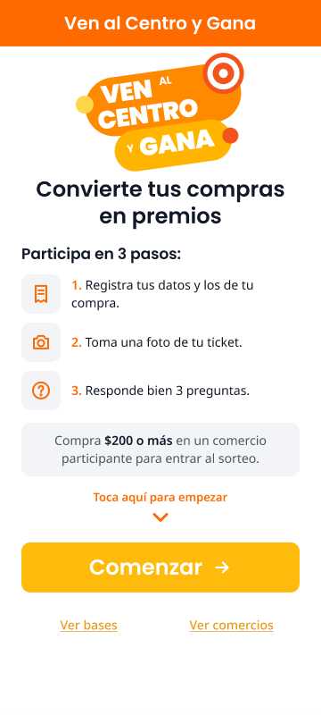 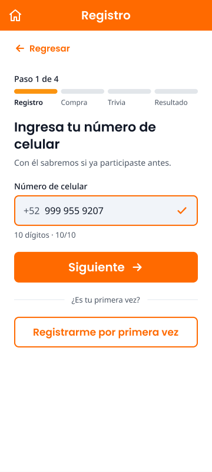 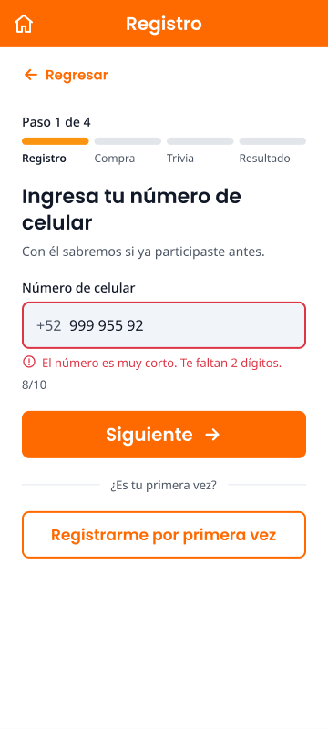

- **01 · Inicio:** logo, título "Convierte tus compras en premios", 3 pasos numerados, recuadro de compra mínima de $200, indicador "Toca aquí para empezar" con flecha, botón "Comenzar" y enlaces "Ver bases" y "Ver comercios".
- **02 · Ingreso con teléfono:** "Paso 1 de 4", campo con prefijo "+52" y contador de dígitos, botón "Siguiente" y botón "Registrarme por primera vez".
- **02b · Teléfono con error:** borde rojo y el mensaje "El número es muy corto. Te faltan 2 dígitos."

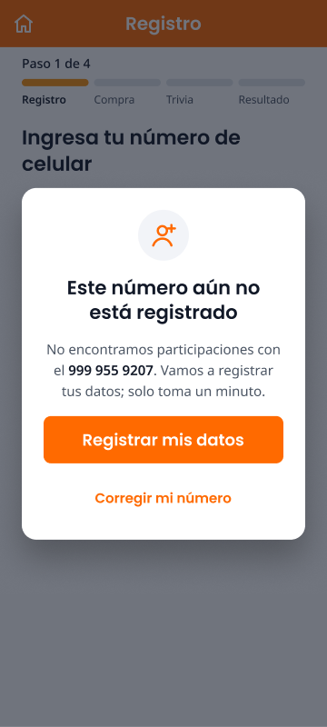 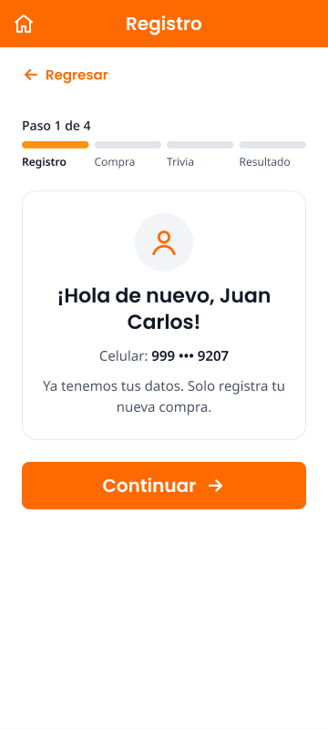 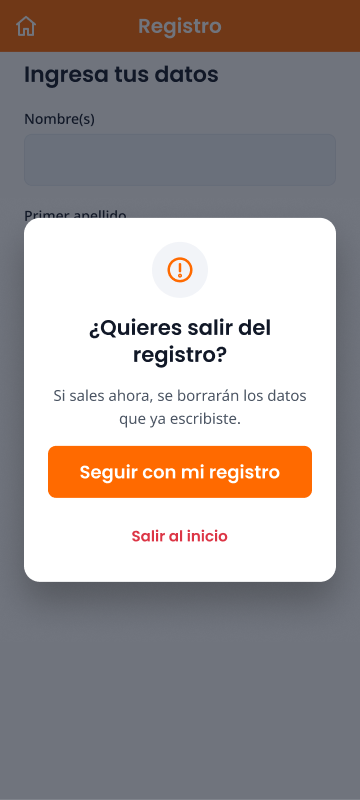

- **03 · Número no registrado:** ventana emergente con los botones "Registrar mis datos" y "Corregir mi número".
- **03b · Usuario ya registrado:** "¡Hola de nuevo, Juan Carlos!" con el número enmascarado y el botón "Continuar".
- **Diálogo · Salir del registro:** "¿Quieres salir del registro?" con los botones "Seguir con mi registro" y "Salir al inicio".

### 2 · Registro de datos

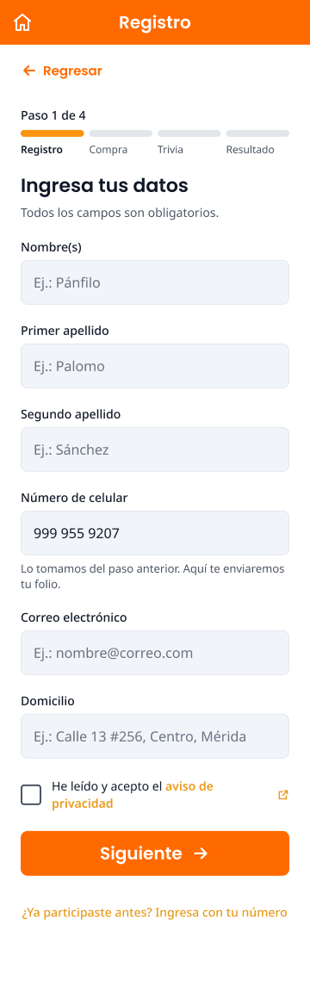 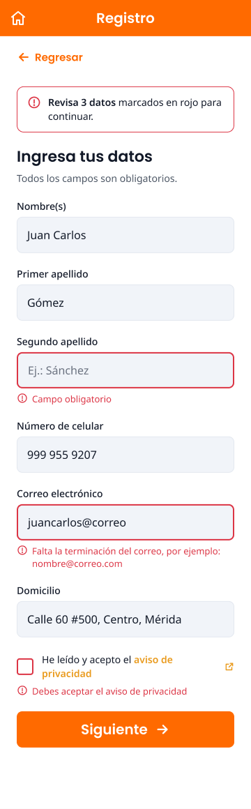

- **04 · Registro de nuevo participante:** seis campos con ejemplos dentro ("Ej.: …"), celular prellenado, casilla del aviso de privacidad y enlace "¿Ya participaste antes? Ingresa con tu número".
- **04b · Registro con errores:** resumen "Revisa 3 datos marcados en rojo para continuar." y un mensaje específico en cada campo con error.

### 3 · Datos de la compra

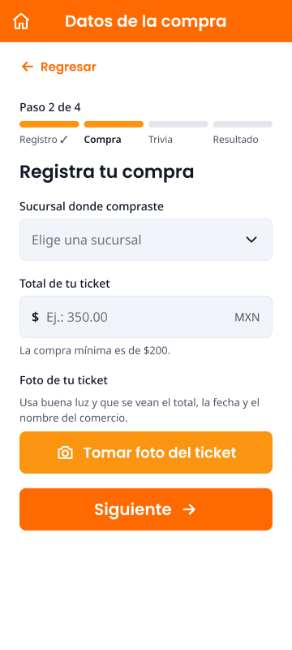 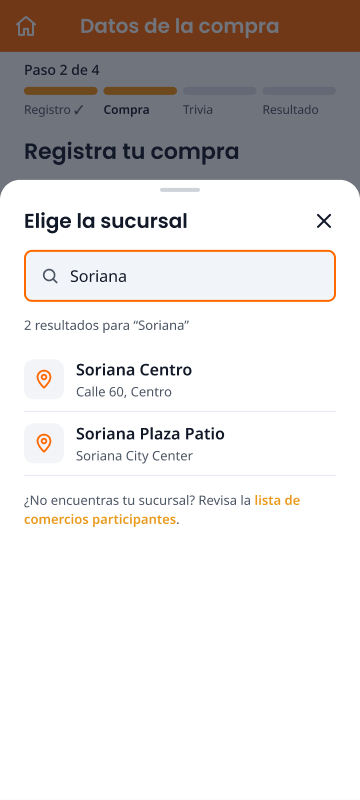 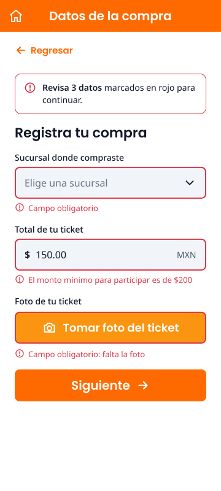 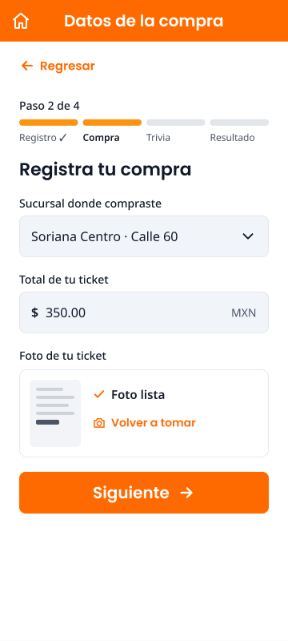

- **05 · Datos de la compra:** campo de sucursal, monto con "$" y "MXN" y la ayuda de compra mínima, instrucción y botón para tomar la foto.
- **05b · Elegir sucursal:** panel inferior con buscador, conteo de resultados, nombre y dirección de cada sucursal, y enlace a la lista de comercios.
- **05c · Compra con errores:** resumen de errores, "Campo obligatorio", monto mínimo y foto faltante.
- **05d · Foto tomada:** vista previa con "Foto lista" y "Volver a tomar".

### 4 · Trivia y resultado

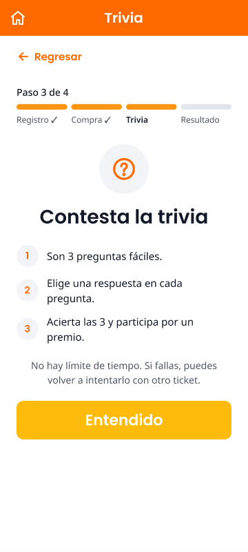 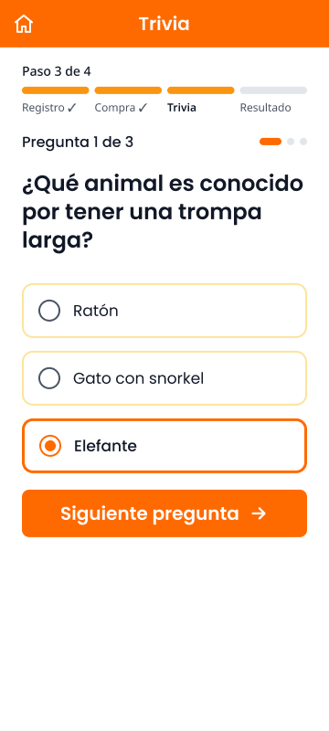 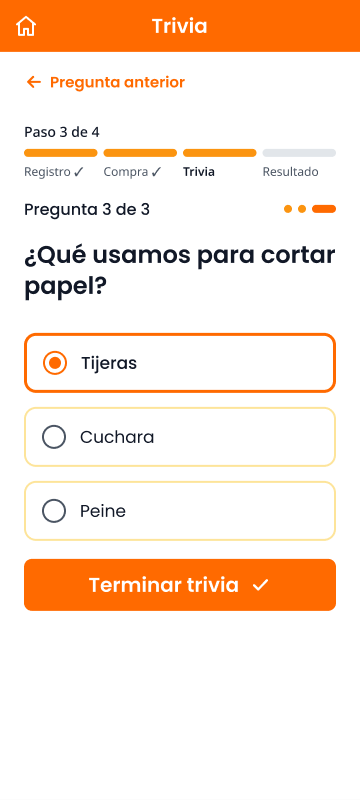

- **06 · Instrucciones:** "Paso 3 de 4", tres reglas numeradas, la nota sobre el tiempo y los reintentos, y el botón "Entendido".
- **07 · Pregunta 1:** contador "Pregunta 1 de 3", opciones como tarjetas (la elegida con borde naranja) y el botón "Siguiente pregunta".
- **09 · Pregunta 3:** enlace "Pregunta anterior" y botón "Terminar trivia".

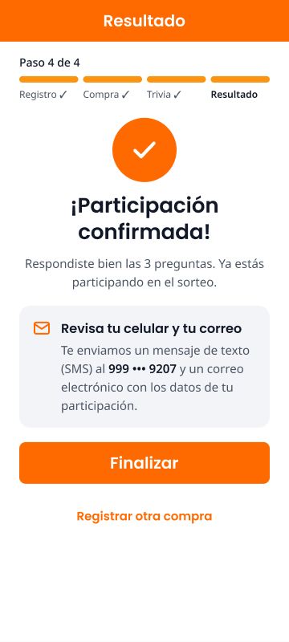 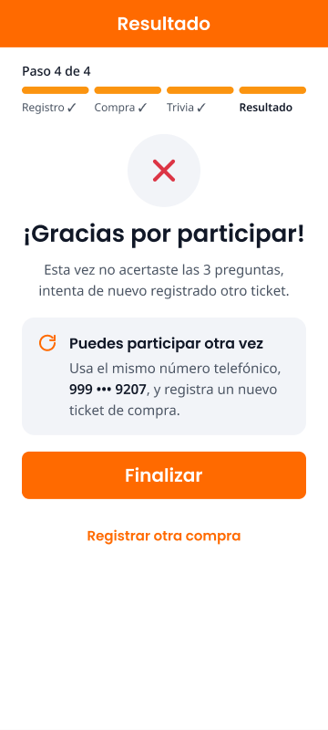

- **10 · Respuestas correctas:** "¡Participación confirmada!" y la tarjeta "Revisa tu celular y tu correo". El folio se envía por SMS y correo; no se muestra en pantalla.
- **10b · Respuestas incorrectas:** "¡Gracias por participar!" y la tarjeta "Puedes participar otra vez".
- Ambas pantallas tienen los botones "Finalizar" y "Registrar otra compra".

---

## Evolución del diseño (versión 1 → versión 2)

| Aspecto | Versión 1 | Versión 2 |
|---|---|---|
| Pantallas | 12 pantallas y 3 estados | 17 pantallas, con estados de error, diálogos y panel de búsqueda |
| Botón "Regresar" | Botón naranja relleno | Enlace de texto arriba, con menor énfasis (RNF-003) |
| Indicador de paso | Barra única | Barra de 4 etapas con nombre y ✓ (RNF-007) |
| Ejemplos de los campos | Junto a la etiqueta, en gris muy claro | Dentro del campo, "Ej.: …" (RNF-002) |
| Errores | Texto suelto en algunas pantallas | Borde rojo, ícono, mensaje específico y resumen (RF-021, RNF-010) |
| Selección de sucursal | Lista desplegable vacía | Panel con buscador (RF-017) |
| Foto del ticket | Solo el botón | Instrucción y vista previa (RF-018) |
| Trivia | Opciones tipo radio | Tarjetas con contador y navegación (RF-019, RNF-006) |
| Resultado | Folio pendiente y botón "Volver a participar" | Aviso de envío por SMS y correo, "Finalizar" y "Registrar otra compra" (RF-014, RF-020) |
| Pendientes de la versión 1 | Sin flecha en el inicio, sin vista previa de la foto | Resueltos |

---

## Pendientes del diseño

- [ ] Corregir la errata de la pantalla 10b: "regist**rado** otro ticket" → "regist**rando** otro ticket".
- [ ] Ajustar el contraste del texto blanco sobre los botones naranjas y amarillos (RNF-005; ver [guía de diseño](design-guide.md), sección 2.3).
- [ ] Enlazar las pantallas en Figma como prototipo navegable, para la simulación de tarea con el cliente.
- [ ] Validar el diseño con CANACO SERVYTUR y registrar sus comentarios.
